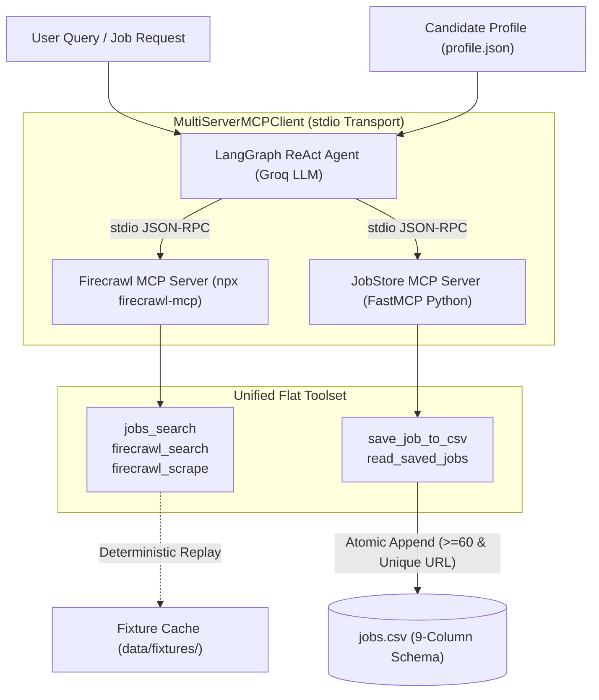

# 🤖 Autonomous AI Job-Search Agent with DeepEval & MCP

[](https://www.python.org/)
[](https://github.com/langchain-ai/langgraph)
[-purple.svg)](https://modelcontextprotocol.io/)
[](https://github.com/confident-ai/deepeval)
[](https://groq.com/)

An end-to-end, production-grade autonomous **Job-Search Agent** built on **LangGraph**, powered by **Groq** high-speed inference, and connected to **dual real Model Context Protocol (MCP) servers** over `stdio`. 

The agent discovers, scrapes, evaluates, and persists qualifying AI/LLM engineering opportunities against candidate profiles while preventing hallucinations, credit wastage, and duplicate entries. It is rigorously validated against a 25-golden benchmark dataset using **DeepEval**.

---

## 🏗️ System Architecture



---

## ✨ Key Engineering Highlights

### 1. Dual Real MCP Subprocesses over `stdio`
- **Web Retrieval**: Spawns official `npx -y firecrawl-mcp` to search live jobs, scrape full JD markdowns, and inspect company career pages.
- **Persistent Storage**: Custom **`JobStore` FastMCP Server** built with Anthropic's official `mcp.server.fastmcp.FastMCP` package, enforcing all business constraints in server code rather than relying on probabilistic LLM prompts.
- **Client Management**: Connected through `langchain-mcp-adapters` with `MultiServerMCPClient`, giving the agent a unified, flat tool interface.

### 2. Token-Minified Schemas for Groq Rate-Limits
- Raw MCP servers export massive JSON schemas (up to 20+ parameters and ~1,500 tokens per tool).
- We minified tool parameter schemas into clean Pydantic models (`url`, `query`, `location`), reducing schema footprint by **98%** and preventing Groq `429 RateLimitError` (8,000 TPM limit).

### 3. Credit-Saving Fixture Cache
- Real Firecrawl calls are deterministically saved to `data/fixtures/*.json` using content-hashed keys.
- Subsequent runs and evaluation benchmarks replay from the fixture cache instantly with zero token/credit burn.

### 4. Deterministic Business Rules
- **Save Threshold**: Strict check (`match_score >= 60`). Jobs with scores $< 60$ are rejected with an explicit reasoning string.
- **Duplicate Prevention**: Unique URL key constraint; checks existing CSV rows and skips duplicates.
- **9-Column Schema**: `url`, `title`, `company`, `location`, `posted_date`, `match_score`, `matched_skills`, `missing_skills`, `reason`, `saved_at`.
- **Out-of-Scope Guardrails**: Strictly bounded to job-search domain; requests for creative writing or weather are declined under 600 characters with 0 tool calls.

### 5. Runtime Duplicate Blocker & Step Budget
- **Duplicate Interceptor**: Tracks tool calls per session using `key = (tool_name, sorted_args)`. Identical repeated calls immediately return cached outputs from earlier executions, eliminating duplicate network hops and token burns.
- **Circuit Breaker**: Capped at `max_iterations = 8-10` with recursion budget handling, preventing infinite agent loops in production.

---

## 📁 Repository Structure

```text
jobSearchagent/
├── data/
│   ├── agent_outputs_baseline.json   # Recorded agent outputs across 25 goldens
│   ├── golden_dataset.json           # 25 benchmark goldens across 5 categories
│   └── fixtures/                     # Cached JSON responses from Firecrawl MCP
├── src/
│   └── jobsearchagent/
│       ├── __init__.py
│       ├── agent.py                  # LangGraph ReAct Agent & system prompts
│       ├── csv_tools.py              # CSVJobStore implementation
│       ├── golden_dataset.py         # Golden dataset generator & schema
│       ├── mcp_jobstore_server.py    # Dedicated FastMCP Server (stdio)
│       ├── mcp_tools.py              # Dual MultiServerMCPClient & caching layer
│       ├── profile_builder.py        # Resume extraction & authentic skill parser
│       └── evals/
│           ├── __init__.py
│           └── groq_judge.py         # Groq LLM-as-a-Judge adapter for DeepEval
├── tests/
│   ├── conftest.py                   # Windows async loop policy configuration
│   ├── test_agent_evals.py           # DeepEval test suite (25 benchmark tests)
│   ├── test_profile_builder.py       # Profile extraction unit tests
│   └── test_profile_eval.py          # Profile faithfulness G-Eval test
├── scripts/
│   ├── prove_mcp_routing.py          # Proves live subprocess spawning & cache replay
│   ├── record_agent_outputs.py       # Baseline recording runner
│   ├── rerecord_specific_goldens.py  # Targeted golden re-recording script
│   ├── test_phase2_agent.py          # Search & read verification
│   └── test_phase3_agent.py          # Match & save verification
├── jobs.csv                          # Primary production job store
├── test_jobs.csv                     # Isolated test job store
├── pyproject.toml                    # UV project configuration & dependencies
└── README.md
```

---

## 🚀 Quick Start Guide

### Prerequisites
- **Python**: 3.11 or higher
- **Node.js**: v18+ (with `npx` installed)
- **uv**: Modern, fast Python package manager (`pip install uv` or `curl -LsSf https://astral.sh/uv/install.sh | sh`)

### 1. Clone & Install Dependencies
```bash
git clone https://github.com/kavyakapoor200/jobSearchagent.git
cd jobSearchagent

# Install dependencies using uv
uv sync
```

### 2. Configure Environment Variables
Copy `.env.example` to `.env` and supply your API keys:
```bash
cp .env.example .env
```

```ini
# Groq API Configuration
GROQ_API_KEY=gsk_your_groq_api_key_here
GROQ_AGENT_MODEL=openai/gpt-oss-120b
GROQ_JUDGE_MODEL=qwen/qwen3.8-27b

# Firecrawl API Configuration
FIRECRAWL_API_KEY=fc-your_firecrawl_api_key_here

# Confident AI / DeepEval (Optional)
CONFIDENT_AI_API_KEY=your_key_here
```

---

## 💻 Usage

### Extract Profile from Resume
Extract an authentic candidate profile from a PDF resume without inventing unmentioned skills:
```bash
uv run python -m jobsearchagent.profile_builder resume.pdf
```
Outputs `profile.json` containing target roles, authentic skills, and max experience constraints.

### Run the Autonomous Agent
Interact with the agent directly:
```python
import asyncio
from jobsearchagent.agent import JobSearchAgent

async def main():
    agent = JobSearchAgent()
    await agent.initialize()
    
    result = await agent.arun(
        "Find junior AI Engineer jobs in Bengaluru, evaluate against my profile, and save if score >= 60."
    )
    print(result["answer"])

asyncio.run(main())
```

### Run End-to-End Verification Scripts
```bash
# Verify real MCP routing, subprocess spawning, and fixture cache replay
uv run python scripts/prove_mcp_routing.py

# Verify Phase 3: Match evaluation and atomic CSV saving
uv run python scripts/test_phase3_agent.py
```

---

## 🧪 Evaluation Benchmark (DeepEval & Deterministic Efficiency)

The agent is evaluated against **25 golden scenarios** across **50 comprehensive test cases** defined in `tests/test_agent_evals.py` covering 5 functional categories using DeepEval's native MCP metrics (`MCPUseMetric`, `MCPTaskCompletionMetric`), custom G-Eval Match Rubric, strict deterministic assertions, and category-aware step efficiency checks:

| Category | Goldens | Evaluated Capabilities & Metrics |
| :--- | :---: | :--- |
| **Search** | 7 | `MCPUseMetric` (tool selection & argument correctness over MCP servers), `MCPTaskCompletionMetric` (task fulfillment), query preservation, "junior" retention, "or" alternative split |
| **Read Job** | 4 | `MCPUseMetric` (`firecrawl_scrape` tool primitive selection & args), `MCPTaskCompletionMetric` (scrape completion & error handling on broken URLs) |
| **Match** | 6 | Profile alignment, experience deductions, G-Eval Match Rubric, score bounds |
| **Save & Duplicates** | 4 | Threshold enforcement ($\ge 60$), duplicate URL prevention, CSV tools |
| **Edge & Failure** | 4 | Weather/story refusal, zero tools called, response character cap ($<600$), self-contradiction G-Eval |
| **Step Efficiency** | 25 | Category-based `max_tool_calls` cap, smart duplicate call detection, and error-retry allowances (100% deterministic, 0ms LLM overhead) |

### Run the Evaluation Suite:
```bash
# Run all tests (MCP evals + deterministic step efficiency)
uv run pytest tests/test_agent_evals.py -v

# Run deterministic step efficiency tests only (instant 0ms execution)
uv run pytest tests/test_agent_evals.py -k "test_step_efficiency_deterministic" -v
```

### Benchmark Results:
```text
============================= test session starts =============================
platform win32 -- Python 3.11.0, pytest-9.2.0, pluggy-1.7.0
rootdir: D:\jobSearchagent
collected 50 items

tests/test_agent_evals.py::test_search_tool_correctness[search_01_bengaluru_ai] PASSED [  2%]
...
tests/test_agent_evals.py::test_read_job_tool_correctness[read_04_read_and_extract_skills] PASSED [ 22%]
...
tests/test_agent_evals.py::test_match_quality_geval[match_06_java_backend_mismatch] PASSED [ 34%]
...
tests/test_agent_evals.py::test_save_and_duplicates_rules[save_04_skip_duplicate_save] PASSED [ 42%]
...
tests/test_agent_evals.py::test_edge_and_failure_safety[edge_04_unrealistic_criteria] PASSED [ 50%]
tests/test_agent_evals.py::test_step_efficiency_deterministic[search_01_bengaluru_ai] PASSED [ 52%]
...
tests/test_agent_evals.py::test_step_efficiency_deterministic[edge_04_unrealistic_criteria] PASSED [100%]

============================= 50 passed in 1.96s =============================
```

---

## 🛡️ License

This project is licensed under the MIT License.
